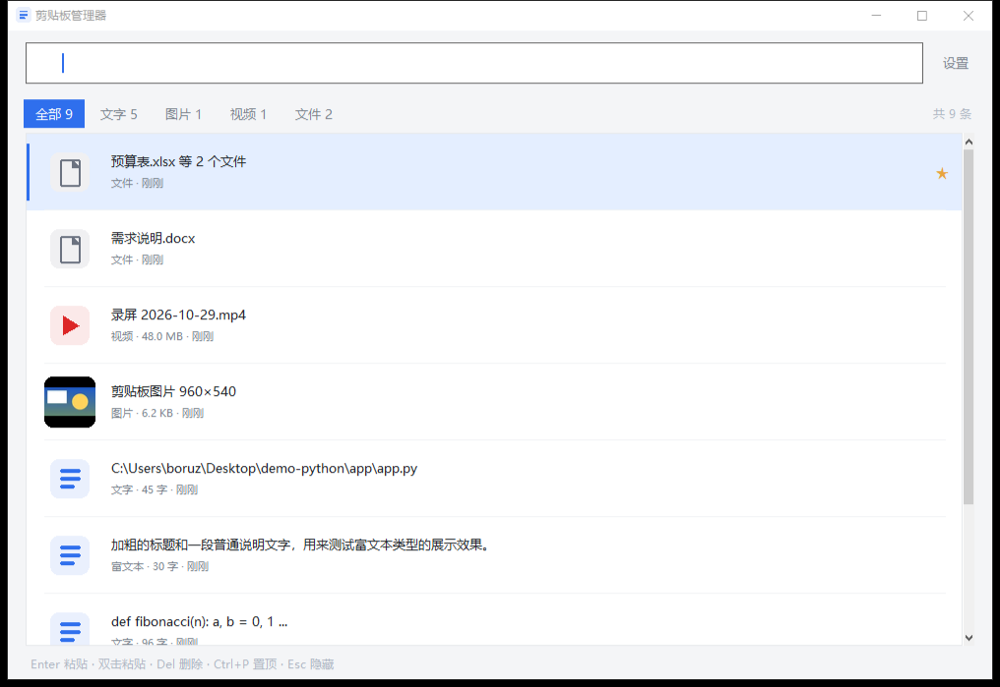
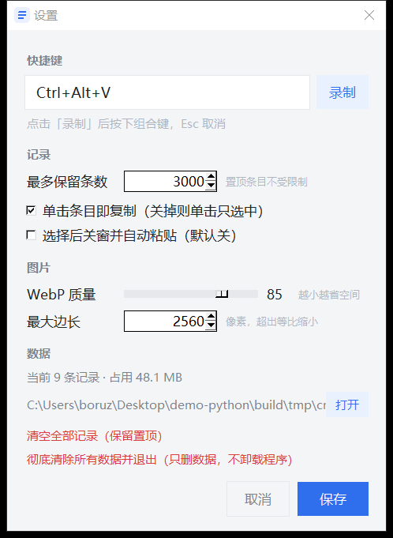

# 剪贴板管理器

Windows 上的轻量剪贴板历史工具：**文字 / 图片 / 视频（含任意文件）分开记录**，支持即时搜索和模糊搜索，按一下热键就回到刚工作的地方。

纯 Python + Tkinter 实现，单文件 exe 打包，常驻内存约 40 MB，空闲 CPU ≈ 0。





---

## 快速开始

两种包，任选其一：

| 产物 | 说明 |
| --- | --- |
| `dist\ClipboardManager.exe` | 单文件，双击即用（首次启动会先解压到临时目录，慢 1–2 秒） |
| `dist\ClipboardManager-portable\ClipboardManager.exe` | 文件夹版，**双击后必须整个文件夹一起保留**；启动快，不会碰临时目录 |

- **从源码跑**（本机 Python 3.13）：

  ```powershell
  .venv\Scripts\python.exe -m pip install -r requirements.txt
  .venv\Scripts\python.exe run.py
  ```

启动后缩到系统托盘，窗口默认不弹出。

> 如果单文件版报 `Could not create temporary directory!`，直接用文件夹版——原因见下面的「常见问题」。

## 项目结构

```
app/            程序本体（装配、配置、存储、监听、剪贴板读写、图片、热键、托盘、UI）
tools/          自测与调试脚本（不参与打包）
docs/           截图与开发笔记
run.py          源码入口
build.py        PyInstaller 打包脚本
requirements.txt      运行时依赖（Pillow、pystray）
requirements-dev.txt  再加打包用的 PyInstaller
pyproject.toml  包元数据 + ruff / pyright 配置
```

细节见 [docs/dev-notes.md](docs/dev-notes.md)（含 venv 的 Tcl/Tk 环境变量、打包命令、测试环境限制）。

## 用法

| 操作 | 说明 |
| --- | --- |
| `Ctrl+Alt+V` | 唤出/隐藏窗口（快捷键可在设置里改） |
| **单击条目** | **复制到剪贴板，窗口保留**；切回你的输入框按 `Ctrl+V` 即可（设置里可改成"单击只选中"） |
| `Enter` / 双击 | 同上，复制到剪贴板 |
| 直接输入 | 边打边筛，中文、代码、路径都能搜 |
| `↑` `↓` | 上下选择 |
| `Esc` | 收起窗口 |
| `Delete` | 删除选中记录 |
| `Ctrl+P` | 置顶/取消置顶（置顶的不会被自动清理） |
| `Ctrl+F` | 回到搜索框 |
| 右键条目 | 复制（窗口不关）/ 复制并关窗粘贴 / 置顶 / 删除 |
| 顶部标签 | 全部 / 文字 / 图片 / 视频 / 文件 分类型查看 |

窗口顶部显示每类条数；列表右侧 `★` 是置顶项。

> 想要"点一下就自动填进输入框"（像 Win+V）：在设置里勾上**「选择后关窗并自动粘贴」**。代价是窗口会关闭，而且目标窗口得能抢回前台。

### 三种类型分别怎么处理

| 类型 | 怎么存 | 怎么粘回去 |
| --- | --- | --- |
| 文字 | 原文存在本地数据库（带 HTML 富文本时一并保留格式） | 以文字/富文本写入剪贴板 |
| 图片 | 复制的是「位图」时保存一份 WebP（默认质量 85，可调）；复制的是图片**文件**时只记路径 | 以位图写入（带透明的图会用 PNG 格式，粘到 PPT/浏览器不糊） |
| 视频 / 文件 | **只记原路径，不复制文件** | 以文件清单写入，粘贴时是真正的文件 |

> 视频和文件是按扩展名归类的：`.mp4/.mkv/.mov…` 进「视频」，`.txt/.docx/.zip…` 进「文件」。

## 数据存在哪

- 默认：`%APPDATA%\ClipboardManager\`
  - `clipboard.db` sqlite 数据库（记录 + 搜索索引）
  - `images\` `thumbs\` 图片和缩略图（WebP）
  - `config.json` 设置
  - `error.log` 启动信息和异常（排查问题时看这个）
- **便携模式**：在 exe 同目录放一个空文件 `portable.flag`，数据改存到 exe 旁边的 `data\`。

默认最多留 3000 条，超出时先删最旧的（置顶不动），并把对应的图片文件一起删掉。

## 清除数据 / 卸载

两种清法，按需要选：

| 想干什么 | 怎么做 | 影响范围 |
| --- | --- | --- |
| 清掉历史记录 | 设置 →「清空全部记录」，或列表里 `Delete` / 右键删除单条 | 记录 + 对应的图片文件；**置顶的会保留**，设置不变 |
| 彻底清除并退出 | 托盘右键 →「清除全部数据并退出…」，或 设置 →「彻底清除所有数据并退出」 | 全部记录（含置顶）、`images\`、`thumbs\`、`config.json`、`error.log`，**数据目录本身也删掉**，然后程序退出 |
| 卸载前清干净 | 命令行执行 `ClipboardManager.exe --purge`（也可以用 `--uninstall`） | 同上；程序没运行时会先弹确认框，删完提示结果 |

> 「彻底清除」只删数据、**不删 exe**：程序删不掉正在运行的自己。真正的卸载是删掉 `ClipboardManager.exe` 这个文件。

**卸载步骤**：先退出程序（托盘 →「退出」）→ 执行 `ClipboardManager.exe --purge` 清掉数据 → 删除 `ClipboardManager.exe`。程序是绿色单文件，不留注册表、不留服务，删掉 exe 就等于卸载干净；`--purge` 只是帮你把 `%APPDATA%\ClipboardManager\`（便携模式是 exe 旁边的 `data\`）一并清掉。

## 设置

托盘右键 →「设置」，或窗口右上角「设置」：

- 全局快捷键：点「录制」按组合键，需含 Ctrl/Alt/Shift 之一
- 最多保留条数
- 单击条目即复制（关掉后单击只选中，双击/回车才复制）
- 选择后关窗并自动粘贴（**默认关**；打开就变成 Win+V 那种"点一下直接填进输入框"）
- 图片 WebP 压缩质量、最大边长（超出的等比缩小）
- 「数据」区显示当前条数与占用空间；下方是「清空全部记录」和「彻底清除所有数据并退出」

## 从源码构建

```powershell
$env:TCL_LIBRARY = "D:\Python\Python313\tcl\tcl8.6"   # 必须，否则打包收不到 tcl/tk
$env:TK_LIBRARY  = "D:\Python\Python313\tcl\tk8.6"
.venv\Scripts\python.exe build.py                     # 两个产物都打
.venv\Scripts\python.exe build.py --onefile           # 只打单文件
.venv\Scripts\python.exe build.py --portable          # 只打文件夹版
```

图标在构建时由代码画出来。依赖装法：`pip install -r requirements-dev.txt`。

## 常见问题

**双击 `ClipboardManager.exe` 弹 `Error: Could not create temporary directory!`**

单文件版启动时要把自己解压到 `%TEMP%` 下的一个临时目录（PyInstaller 的 onefile 机制），某些环境不允许创建这个目录：安全软件拦截、`%TEMP%` 被组策略指到不可写的位置、磁盘满、或者进程跑在受限令牌里。这时：

1. 改用文件夹版 `dist\ClipboardManager-portable\ClipboardManager.exe`（不需要解压，已在同一台机器验证可用）；
2. 想继续用单文件版，先跑 `dist\ClipboardManager-debug.exe` 看具体卡在哪一步（这个版会把加载器日志打到控制台）。

**两个版本能同时用吗？** 不能，同一时间只能跑一个（程序用命名互斥体保证唯一实例，重复启动会提示"已经在运行"）。

**右下角托盘里找不到图标？**

Windows 10 默认会把**新出现的**托盘图标塞进 `^` 折叠区，所以任务栏上常常看不到。三种处理：

1. 点任务栏上的 `^`，图标就在里面；拖出来即可固定在任务栏上；
2. 设置 → 个性化 → 任务栏 →「选择哪些图标显示在任务栏上」→ 把「剪贴板管理器」打开；
3. 找不到图标也不影响用——按 `Ctrl+Alt+V` 照样唤出窗口。

程序在**第一次启动**时会自动弹出主窗口并弹一次气泡提示图标位置；之后启动只在托盘待着。如果连气泡都没看到，看 `%APPDATA%\ClipboardManager\error.log`，里面有一行 `托盘图标已创建` 或具体的失败原因（托盘起不来时会自动弹出窗口兜底）。

**从聊天窗口 / 编辑器里点开 exe，会出古怪**

有些人是从聊天软件的"文件卡片"、IDE 的"运行"按钮这类地方点开的，进程会继承那个程序的**受限令牌**。表现是三个症状一起来：

- 数据写不进 `%APPDATA%`，`error.log` 里出现 `数据目录不可写：...`；
- 托盘图标**哪里都不显示**（包括 `^` 里）——受限进程碰不到资源管理器的通知区域；
- 点条目后**不自动粘贴**——受限进程的按键注入被系统拦掉（UIPI）。

对策：到资源管理器里打开 `dist\ClipboardManager-portable\`，**直接双击 `ClipboardManager.exe`**。程序启动时会自检，发现 `%APPDATA%` 不可写就会弹窗提示"检测到受限运行环境"。

## 自测

```powershell
.venv\Scripts\python.exe tools\selftest.py        # 单元级：存储/搜索/DIB 转换/界面构建
.venv\Scripts\python.exe tools\e2e.py             # 端到端：真实剪贴板 → 监听 → 入库 → 回写 → 热键 → 托盘
.venv\Scripts\python.exe tools\paste_test.py      # 自动粘贴链路（前台被占用时自动降级为只验证写回）
.venv\Scripts\python.exe tools\purge_test.py      # 清除功能：含置顶清空、图片文件删除、目录删除、--purge
.venv\Scripts\python.exe tools\click_paste_test.py # 单击条目直接粘贴（接线 + 真实输入框）
```

## 实测数据（2026-10-29，本机）

- 常驻内存：工作集 39 MB / 私有 25 MB；空闲 15 秒 CPU 时间 0.000 s（300 ms 轮询 `GetClipboardSequenceNumber`，序号没变就不读剪贴板）。
- 单文件版 19.5 MB；文件夹版 39.8 MB（955 个文件，含 Tcl/Tk、Pillow、pystray）。
- 自测：`selftest` 20 项、`e2e` 14 项、`paste_test` 3 项、`purge_test` 9 项，全部通过。
- 打包版实机验证：文件夹版启动后进程存活、Tcl/Tk 正常渲染（DPI 125%）、`error.log` 无异常、热键注册成功；`--purge` 能清空数据目录。

## 已知限制

- 视频/文件是**路径引用**：原文件被移动或删掉后，粘回去会提示「原文件已不存在」。
- 只监听 Windows 剪贴板；程序自己写回剪贴板时会跳过一次，不会自我记录。
- 搜索 3 个字符以上走 FTS5 trigram 索引；1–2 个字符自动退回 `LIKE` 模糊匹配（结果一致，速度略慢）。
- 快捷键被其它程序占用时不会静默：启动会弹提示，设置里改的时候会告诉你冲突。
